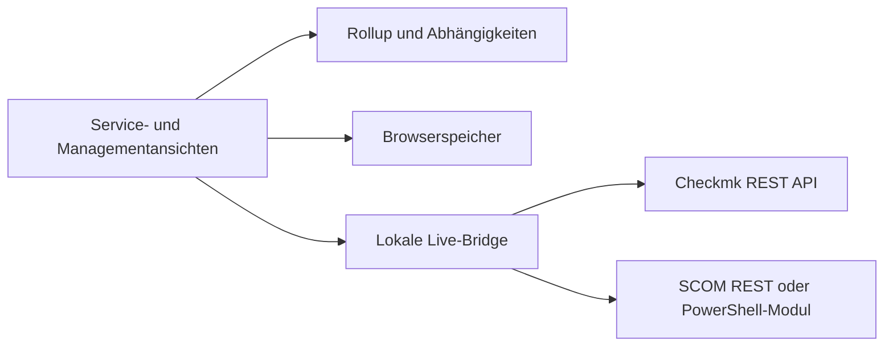

# Architektur und Datenmodell

Service Atlas ist ein lokaler Prototyp aus statischen HTML-, CSS- und JavaScript-Dateien. Ein Browser speichert die Bäume im `localStorage`; ein optionaler Node.js-Prozess stellt lesende Zugriffe auf Monitoringquellen bereit. Es gibt derzeit weder einen zentralen Datenspeicher noch Benutzerverwaltung oder eine produktionsreife Mehrbenutzerarchitektur.

## Dateien

| Datei | Aufgabe |
| --- | --- |
| `app.js`, `views.js` | Bearbeitung, Simulation, Serviceansichten |
| `management.js` | Übersicht und Drilldown über Servicebäume |
| `model.js` | Abhängigkeiten, Validierung und Rollup |
| `catalog.js` | Gemeinsame Komponenten und deren Stammdaten |
| `bridge.js` | Übersetzung und Zuordnung simulierter Zustände |
| `live-ui.js`, `live-server.js`, `live-adapters.js` | Live-Auswahl, lokaler Vermittler und Quelladapter |
| `scom-rest-read.ps1`, `scom-read.ps1` | SCOM-REST-Zugriff bzw. Zugriff über OperationsManager-Modul |
| `owl-examples.js` | Fiktive, an Produktnamen orientierte Beispiele |

## Modell und Zustände

Ein Servicebaum enthält Komponenten in benannten Bereichen. Komponenten haben IDs, einen Rohzustand und können direkte Abhängigkeiten auf Komponenten desselben Baums besitzen. Der gemeinsame Katalog verknüpft Verwendungen per `catalogId`; Bereichszuordnung und Abhängigkeiten bleiben baumspezifisch. Ein `liveRef` identifiziert explizit zugeordnete Quellobjekte; Demo-Objekte werden nicht automatisch mit Live-Objekten gleichgesetzt.

`model.js` berechnet den abgeleiteten Zustand rekursiv aus dem Rohzustand und Pflichtabhängigkeiten. Optionale Kanten bleiben sichtbar, beeinflussen die abhängige Komponente aber nicht. Pflichtbereiche verwenden den schlechtesten Zustand; redundante Bereiche die konfigurierte Mindestanzahl verfügbarer Komponenten. Informative Bereiche beeinflussen den Servicezustand nicht. Die Rangfolge lautet CRIT, UNKNOWN, WARN, OK. Ein fehlender, ungültiger oder mehr als drei Minuten alter Live-Abruf wird für die Berechnung UNKNOWN; der Zeitstempel misst die erfolgreiche Bridge-Abfrage, nicht den letzten Check in der Quelle.

Die Abhängigkeitsrichtung lautet „Komponente benötigt Voraussetzung“. Eine optionale Kante verhindert nicht, dass der Bereich der Zielkomponente selbst den Gesamtzustand beeinflusst. Abhängigkeiten und Geschäftsservicezuordnungen werden derzeit manuell gepflegt und aus den Quellen nicht automatisch erkannt.

## Live-Datenfluss

Die Website auf `127.0.0.1:8765` fragt bei geöffnetem Servicebaum die lokale Bridge auf Port 8766 ab. Die Bridge verwendet ausschließlich serverseitige Zugangsdaten, fragt die konfigurierten Quellen ab und liefert Objekte samt Rohzustand an den Browser. Ausgewählte Objekte werden per Quellkennung mit Katalogkomponenten verknüpft. Der Browser führt bei Live-Komponenten periodisch Abfragen durch und aktualisiert den lokalen Speicher. Die Managementseite liest diesen Speicher; sie betreibt keinen eigenen Hintergrundabruf. Details und Einschränkungen stehen im [Betriebshandbuch](betrieb.md).

Die Tests decken die Modelllogik und Adapter mit simulierten Antworten ab. Sie ersetzen keine Prüfung gegen eine konkrete SCOM- oder Checkmk-Installation.
